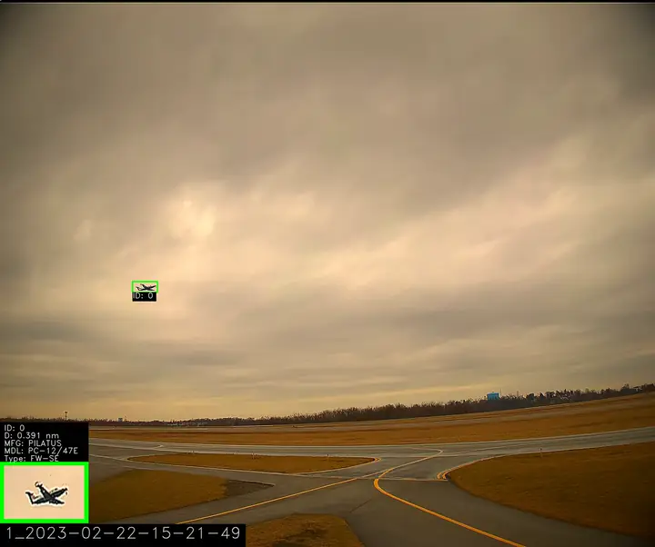
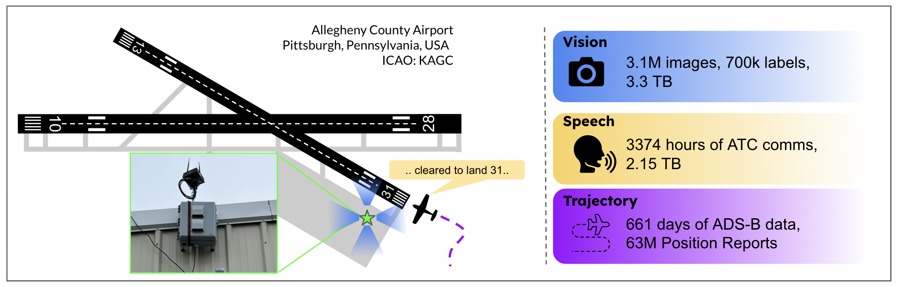

# TartanAviation

**Image, speech, and ADS-B trajectory datasets for terminal airspace operations**

[](https://doi.org/10.1038/s41597-025-04775-6)
[](https://arxiv.org/abs/2403.03372)
[](https://theairlab.org/tartanaviation/)
[](https://doi.org/10.5281/zenodo.14699101)
[](https://creativecommons.org/licenses/by/4.0/)
[](LICENSE)

<p align="center">
  
  <br>
  <sub>A Pilatus PC-12 departs KAGC. The box, range (0.36 nm) and aircraft type all come from the aircraft's own ADS-B broadcast. Sample video <code>1_2023-02-22-15-21-49</code>.</sub>
</p>

TartanAviation is an open, multi-modal dataset of terminal-area airspace operations, recorded with sensors installed inside the boundaries of two airports near Pittsburgh, PA:

- **KAGC**, Allegheny County Airport, a towered airport
- **KBTP**, Pittsburgh-Butler Regional Airport, a non-towered airport

Collection ran from 2020 to 2023, across seasons, weather and traffic conditions. All data has been filtered and validated.

| Modality | What you get | Airports | Download size |
|---|---|---|---|
| 🎥 [**Vision**](#vision) | ~3.1M images in 550 videos, with aircraft bounding boxes tied to each aircraft's ICAO address, range and type; synchronized ADS-B; per-video weather | KAGC | 3.5 TB |
| 🎙️ [**Speech**](#speech) | ~3,374 hours of ATC radio in 677 daily archives, with per-clip metadata; raw recordings also available | KAGC, KBTP | 543 GB, plus 676 GB raw |
| ✈️ [**ADS-B**](#ads-b) | 661 days of aircraft trajectories, raw and processed | KAGC, KBTP | 2 GB |
| 🌦️ [**Weather**](#weather) | METAR reports for 2020 to 2022 | KAGC, KBTP | in repo |

<p align="center">
  
</p>

### By the numbers

- 🛩️ **239 aircraft** are labelled in the vision set: 129 multi-engine, 74 single-engine, and 36 helicopters.
- 🔁 **72 of them appear in more than one video**. One was filmed 64 times across 6 days, so there's plenty for re-identification.
- 📦 **888,382 bounding boxes**, each tied to the aircraft's ICAO address.
- 🏭 The most common manufacturer is Cessna (39 aircraft), followed by Piper (20), Eurocopter (17) and Boeing (17).
- ❄️ Every snow video and every video with visibility of 2 miles or less comes from a single morning: 18 November 2022.

### Where

```geojson
{
  "type": "FeatureCollection",
  "features": [
    {"type": "Feature", "properties": {"name": "KAGC: Allegheny County Airport", "description": "Towered. Vision, speech, ADS-B."},
     "geometry": {"type": "Point", "coordinates": [-79.9217, 40.3547]}},
    {"type": "Feature", "properties": {"name": "KBTP: Pittsburgh-Butler Regional Airport", "description": "Non-towered. Speech, ADS-B."},
     "geometry": {"type": "Point", "coordinates": [-79.9497, 40.7769]}}
  ]
}
```

**Contents:** [Quick start](#quick-start) · [Vision](#vision) · [Speech](#speech) · [ADS-B](#ads-b) · [Weather](#weather) · [Repository layout](#repository-layout) · [Contact](#contact) · [Citation](#citation) · [License](#license)

## Quick start

The download scripts use only the Python standard library (Python ≥ 3.8), so there is nothing to install.

```sh
git clone https://github.com/castacks/TartanAviation.git
cd TartanAviation

python3 vision/download.py --option Sample   # 2.0 GB: one KAGC video with labels
python3 audio/download.py  --option Sample   # 315 MB: one day of KBTP ATC audio
python3 adsb/download.py   --option Sample   # 733 MB: one year of raw KBTP ADS-B
```

Every script supports the following:

- **`--dry_run`** lists the files and total size before you commit disk space to a multi-terabyte download.
- **Resuming:** rerun the same command after an interruption and it skips finished files and resumes partial ones.
- **`--save_dir DIR`** sets the download location. The default is `./data`.

For tooling, [`croissant.json`](croissant.json) describes the dataset in the [Croissant](https://mlcommons.org/croissant/) format. It covers the per-video metadata, the weather files and the ADS-B archives with SHA-256 checksums, and loads with `mlcroissant`.

A few archives use Deflate64, which Python can't decompress; the scripts extract those with the system `unzip` (`sudo apt install unzip`). The analysis code (`adsb/process.py`, `vision/dataloader.py`) has its own dependencies, listed in [`requirements.txt`](requirements.txt).

---

<a id="vision"></a>

## 🎥 Vision

About 3.1M images from 550 videos recorded at KAGC between June 2022 and February 2023. Each video comes with aircraft bounding-box labels, synchronized ADS-B and a weather summary. The download is 3.5 TB; extracting every frame to PNG takes about 22 TB.

```sh
python3 vision/download.py --option Weather_Type --weather Rain --dry_run
```

Videos are selected using [`vision/weather_stats.csv`](vision/weather_stats.csv), which records the aircraft count, visibility, sky cover and weather for each video:

| `--option` | Downloads | Videos | Size |
|---|---|---|---|
| `Sample` | `1_2023-02-22-15-21-49` | 1 | 2.0 GB |
| `Weather_Type --weather {Snow,Rain,Mist}` | Videos with that weather | 5 / 28 / 2 | |
| `Visibility --threshold MILES` | Videos with visibility ≤ the threshold (default 5) | | |
| `Sky_Cover --sky_cover {CLR,FEW,SCT,BKN,OVC}` | Videos with that lowest cloud layer | | |
| `All` | Everything | 550 | 3.5 TB |

Use `--dry_run` to see the video count and size for any option.

- **`--extract_frames`:** split each video into `<video>_sink/<n>.png` at 24 fps, alongside the labels. Needs [ffmpeg](https://ffmpeg.org/).
- **`--visualize_frames`:** also split the label-overlay video into `<video>_vis_sink/`.
- **Interrupted extraction:** a run stopped partway restarts on the next run.

Each video is named `<n>_<YYYY-MM-DD-HH-MM-SS>` after its recording start time:

```
data/
└── 1_2023-02-22-15-21-49/
    ├── 1_2023-02-22-15-21-49.mp4                 video
    ├── 1_2023-02-22-15-21-49_sink/
    │   ├── 2.png, 3.png, ...                     frames (--extract_frames)
    │   └── <n>.label                             bounding boxes for frame n
    ├── 1_2023-02-22-15-21-49_sink_verified.avi   video with labels drawn on
    ├── 1_2023-02-22-15-21-49_sink_adsb.pkl       {icao24: ADS-B track} synchronized to the video
    ├── 1_2023-02-22-15-21-49_acft_sink.pkl       {frame: {icao24: (icao24, box, aircraft type)}}
    ├── 1_2023-02-22-15-21-49_subtitle.srt
    └── 1_2023-02-22-15-21-49_labels.zip          the .label files, as downloaded
```

Each line of a `.label` file is `x1 y1 x2 y2 index distance manufacturer model type`, where `index` numbers the aircraft within that frame. The aircraft's ICAO 24-bit address, which stays the same across videos, is the key in the two `.pkl` files. Both pickles hold only plain dicts and NumPy scalars.

**PyTorch dataloader:** [`vision/dataloader.py`](vision/dataloader.py) provides `KAGC`, a `torch.utils.data.Dataset` that yields sequences of grayscale frames with their boxes and metadata. Run `--extract_frames` first.

---

<a id="speech"></a>

## 🎙️ Speech

About 3,374 hours of air traffic control radio recorded at KAGC (October 2021 to February 2023) and KBTP (September 2020 to September 2022). It ships as 677 daily archives, 543 GB compressed and about 2.15 TB uncompressed. The unprocessed recordings are also available (676 GB).

```sh
python3 audio/download.py --option Date_Range --start_date 2022-06 --end_date 2022-08 --location kagc --dry_run
```

| `--option` | Downloads | Size |
|---|---|---|
| `Sample` | One day at KBTP (2020-11-02), 13 clips | 315 MB |
| `Date_Range` | Every day from `--start_date` to `--end_date`, inclusive (`YYYY-MM`) | varies |
| `All` | Every day at both airports | 543 GB |
| `Raw` | Unprocessed recordings in two-month archives, kept zipped | 676 GB |

`--location {kbtp,kagc,Both}` picks the airport; the default is `Both`. Each clip is a `.wav` file with a `.txt` metadata file of the same number. Month folders are not zero-padded, which matches the bucket:

```
data/
└── kbtp/
    └── 2020/
        └── 11/
            └── 11-02-20_audio/
                ├── 1.txt
                ├── 1.wav
                ├── ...
                └── 15.wav
```

**Filtering and analysis:** [`audio/filter.sh`](audio/filter.sh) and [`audio/analysis.sh`](audio/analysis.sh) were used to filter the raw recordings and measure speech versus silence; both need `ffmpeg`. Example output is in [`audio/analysis_output.txt`](audio/analysis_output.txt).

---

<a id="ads-b"></a>

## ✈️ ADS-B

661 days of ADS-B aircraft trajectories recorded at KAGC (2021–2022) and KBTP (2020–2022). The data is 2 GB compressed and about 12 GB uncompressed.

```sh
python3 adsb/download.py --option Processed --location kagc
```

| `--option` | Downloads | Size |
|---|---|---|
| `Sample` | Raw KBTP data for 2022 | 733 MB |
| `Processed` | Filtered trajectories for each airport | 607 MB |
| `Raw` | Raw yearly archives for each airport | 1.4 GB |
| `All` | `Processed` + `Raw` | 2.0 GB |

`--location {kbtp,kagc,Both}` picks the airport; the default is `Both`.

```
data/
├── kbtp/
│   ├── processed/
│   │   ├── 1.txt
│   │   └── ...
│   └── raw/
│       ├── 2020/
│       ├── 2021/
│       └── 2022/
│           ├── 01-01-22/
│           │   └── 1.csv
│           └── ...
└── kagc/
    └── ...
```

**Processing:** [`adsb/process.py`](adsb/process.py) filters and processes the raw CSVs into trajectories, using the METAR data in [`weather/`](weather/) to express wind in the runway frame.

---

<a id="weather"></a>

## 🌦️ Weather

[`weather/AGC.csv`](weather/AGC.csv) and [`weather/BTP.csv`](weather/BTP.csv) hold METAR reports for KAGC and KBTP from 2020 to 2022. They were downloaded from the [Iowa Environmental Mesonet](https://mesonet.agron.iastate.edu/request/download.phtml) at Iowa State University and use its ASOS export columns.

---

## Repository layout

```
vision/          download script, PyTorch dataloader, weather_stats.csv, camera recorder
audio/           download script, filter/analysis scripts, radio recorder
adsb/            download script, trajectory processing, ADS-B recorder
weather/         METAR CSVs for KAGC and KBTP
ta_download.py   shared download helper used by the three download.py scripts
croissant.json   Croissant (MLCommons) metadata: files, checksums and columns
```

Each modality's `recording/` folder holds the code that ran on the sensors at the airports.

## Contact

For questions about the dataset, please contact Sebastian Scherer ([basti@andrew.cmu.edu](mailto:basti@andrew.cmu.edu)). For bugs in the scripts, please [open an issue](https://github.com/castacks/TartanAviation/issues).

## Citation

If you find this dataset helpful, please cite:

```bibtex
@article{patrikar2025tartanaviation,
  title   = {Image, speech, and {ADS-B} trajectory datasets for terminal airspace operations},
  author  = {Patrikar, Jay and Dantas, Joao and Moon, Brady and Hamidi, Milad and Ghosh, Sourish and Keetha, Nikhil and Higgins, Ian and Chandak, Atharva and Yoneyama, Takashi and Scherer, Sebastian},
  journal = {Scientific Data},
  volume  = {12},
  number  = {1},
  pages   = {468},
  year    = {2025},
  doi     = {10.1038/s41597-025-04775-6}
}
```

## License

- **Data:** the TartanAviation dataset (vision, speech, ADS-B and weather data) is released under the [Creative Commons Attribution 4.0 International License (CC BY 4.0)](https://creativecommons.org/licenses/by/4.0/). You may share and adapt it for any purpose, including commercial use, provided you give appropriate credit by citing the paper above.
- **Code:** the code in this repository is released under the [BSD 3-Clause License](LICENSE).
